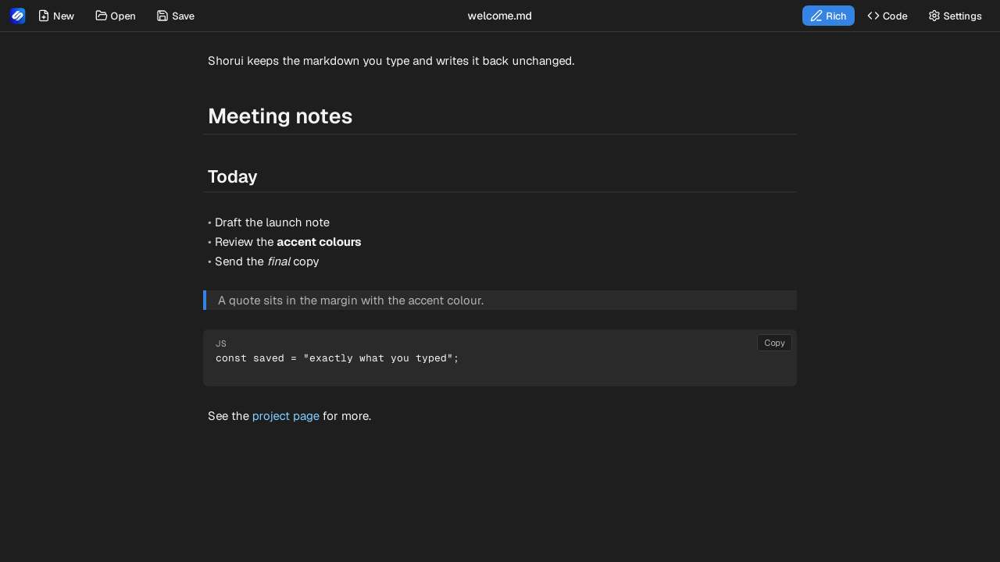
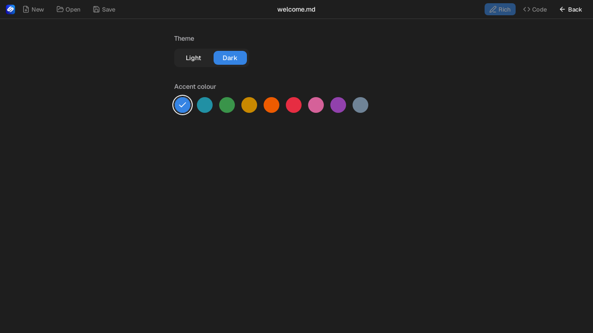

# Shorui looks and behaves like the other desktop apps

23 October 2026 | Issue #7

## What changed

Shorui now matches Taskflow, Zaimu and Allies in how it looks and how its settings work. It starts in the Dark theme with the Blue accent, and the Settings panel offers Light or Dark plus nine accent colours, with the choice kept for the next launch. The header puts New, Open and Save on the left, the file name in the middle, and the Rich, Code and Settings buttons on the right. Every feature Shorui had before still works: the rich editor and code mode, saving exactly what you typed, opening and saving markdown and text files, the unsaved-changes prompt, the save message, the code block copy buttons, undo and redo, and all the keyboard shortcuts. Opening a markdown file from the file manager still loads it in Shorui.

## Why it matters

Shorui no longer feels like a different program from the rest of the desktop suite. One set of themes and accents across the apps makes the group easier to learn, and the settings stay where people expect them. The editor behaves as before, so existing documents and habits carry over.

## Screenshots

